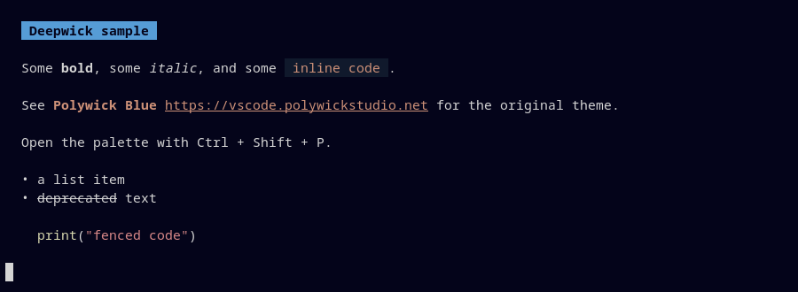

# Deepwick for Glow

Deepwick colors for [Glow](https://github.com/charmbracelet/glow), the terminal Markdown renderer.

> Deepwick is an unofficial theme derived from
> [Polywick Blue](https://vscode.polywickstudio.net) by Polywick Studio (MIT).
> Not affiliated with Polywick Studio.



## Install

```sh
mkdir -p "${XDG_CONFIG_HOME:-$HOME/.config}/glow"
cp deepwick.json "${XDG_CONFIG_HOME:-$HOME/.config}/glow/"
```

## Activate

Per run: `glow -s "${XDG_CONFIG_HOME:-$HOME/.config}/glow/deepwick.json" README.md`.

Permanently, in `${XDG_CONFIG_HOME:-$HOME/.config}/glow/glow.yml`, using the
absolute path (glow does not expand `~` or `$VARIABLES` in `glow.yml`):

```yaml
style: "/home/you/.config/glow/deepwick.json"
```

`echo "style: \"${XDG_CONFIG_HOME:-$HOME/.config}/glow/deepwick.json\""` prints
the line for your system.

The file is a standard [glamour](https://github.com/charmbracelet/glamour)
style, so other glamour-based tools that accept a style file can use it too.

## Notes

- Headings Blue bold (level 1 as a Blue banner), links and inline code Orange,
  block quotes Comment *italic*, rules Muted.
- Code blocks are rendered by chroma in 256 colors, so syntax colors are the
  nearest 256-color match to Deepwick's, not exact.

Tested with Glow 2.1.2.

## License

MIT. See [LICENSE](LICENSE).
